

  

  
  
  

### `> live build log`


### `> how I build`


### `> shipped`

  <a href="https://github.com/Lakshmiyadav65/Perfectprompt"></a>
  <a href="https://github.com/Lakshmiyadav65/oneinfo"></a>
  <a href="https://github.com/Lakshmiyadav65/sona"></a>
  <a href="https://github.com/Lakshmiyadav65/Resume-Builder-and-Job-Recommendation"></a>
  <a href="https://github.com/Lakshmiyadav65/Photo"></a>
  <a href="https://github.com/Lakshmiyadav65/TCSNQT2026"></a>

More in my <a href="https://github.com/Lakshmiyadav65/100projects">project library</a>.

### `> stack`


### `> commit history, eaten daily`

<picture>
  <source media="(prefers-color-scheme: dark)" srcset="https://raw.githubusercontent.com/Lakshmiyadav65/Lakshmiyadav65/output/github-snake-dark.svg" />
  <source media="(prefers-color-scheme: light)" srcset="https://raw.githubusercontent.com/Lakshmiyadav65/Lakshmiyadav65/output/github-snake.svg" />
  
</picture>

