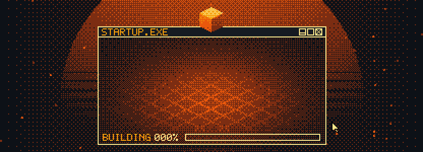
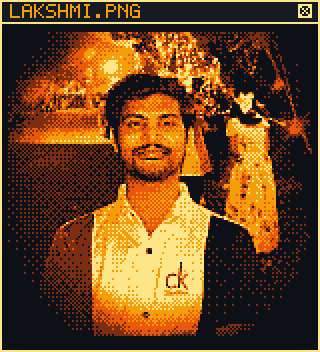

  

<h1 align="center">Hey, I'm Lakshmi 👋</h1>

<h3 align="center">Full-Stack &amp; AI Developer</h3>

  

I build AI products end to end, from the model call to the last pixel on screen.

<h2 align="center">⚡ About Me</h2>

**Lakshmi** here, a developer from Hyderabad studying at Kalasalingam Academy of Research and Education.

I like shipping whole products, not just parts of them: desktop apps in **Rust + Tauri**, backends in **FastAPI** and **Node.js**, frontends in **React / Next.js**, and mobile apps in **Flutter**.

Right now I'm building **AI voice agents** that call and follow up with a business's leads. Recent builds include **PromptAstra** (a hotkey prompt enhancer), **OneInfo** (an AI video pipeline with RAG) and **Sona** (private, local voice dictation).

My loop is simple: idea → prototype → break it → ship it → repeat.

 

<h2 align="center">🤝 Connect</h2>

  &nbsp;
  &nbsp;
  

<h2 align="center">🛠️ Tech Stack</h2>

    
  

<h2 align="center">📊 GitHub Stats</h2>

  

